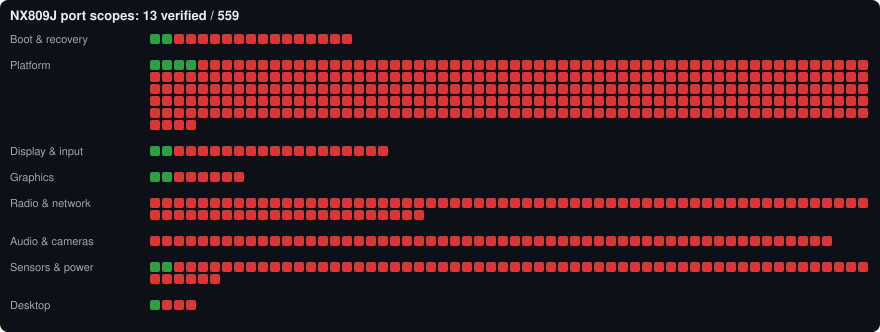

# NX809J Mainline Linux Porting

**Running real desktop Linux on the RedMagic 11 Pro (NX809J, Snapdragon 8 Elite Gen 5 / SM8850),
next to Android, without losing anything.**



> **Status: preparation, not yet bootable.** No Linux has run on the phone yet. Android is
> untouched and is the phone's only working system. See the live [progress board](PROGRESS.md).

## What we're building

| | |
|---|---|
| **Kernel** | A mainline-based Linux kernel (Linux 7.3 family), not the Android kernel |
| **System** | Debian 13 ARM64 |
| **Desktop** | [Denial](https://github.com/denialwm/denial), a touch-friendly Wayland desktop, on the phone screen and on the RedMagic dock |
| **Dual boot** | Switch between Linux and the existing Android whenever you like. Android keeps its apps, data, calibration and **working fingerprint**, and the phone can always go back to stock |

It counts as done only when every piece of hardware passes a real test on the phone and
Android → Linux → Android switching works repeatedly. Compiling a kernel, or getting it to run
on a reference board, doesn't count.

## Where we are

| Milestone | State |
|---|---|
| M0 · Recovery gate: full verified backup and a way back | 🟡 In progress |
| M1 · Kernel baseline: NX809J kernel and device tree | 🟡 In progress |
| M2 · Safe foundation: storage, USB, battery, thermal | ⬜ Not started |
| M3 · Phone and dock hardware: screen, touch, GPU, Wi-Fi, audio… | ⬜ Not started |
| M4 · Denial desktop | 🟡 In progress (builds; not yet run on the phone) |
| M5 · Dual boot and switching | ⛔ Blocked on M0/M1 |
| M6 · Completion | ⬜ Not started |

Details and every verified scope with its proof: **[PROGRESS.md](PROGRESS.md)**.
Dated history: **[docs/MILESTONE-LOG.md](docs/MILESTONE-LOG.md)**.

## Safety promises

1. **Android stays intact.** Slot A, `userdata` and the fingerprint enrollment are never wiped or replaced.
2. **Nothing changes on the phone before a verified full backup** (EDL dump plus hashes).
3. **Your identity partitions stay yours.** IMEI, calibration and keys are never shared or swapped.
   See [which partitions are universal and which are personal](docs/partition-classification.md).
4. **Forum advice is evidence, not a recipe.** Every command is checked against this phone first.
5. **No personal data in this repository.** Backups, captures and build outputs stay on the owner's PC.

## Find your way around

- **[Document map](docs/INDEX.md)**: every document, grouped by question
- **[Glossary](docs/GLOSSARY.md)**: EDL, DTS, UFS, slot A/B and the rest, in plain words
- **[The plan](docs/plan.md)**: milestones and acceptance tests
- **[Safety rules](docs/recovery.md)**: what's backed up and what's forbidden
- **[Hardware status table](docs/hardware-support.csv)**: one row per hardware part

| Folder | What's in it |
|---|---|
| `docs/` | Plans, safety rules, and one report per hardware part or decision |
| `progress/` | The tracker data (`catalog.json`, `milestones.json`) and the local Port Atlas app |
| `tools/` | Read-only phone capture, build, packaging and tracker scripts, with tests |
| `sources/` | Pinned source list (`manifest.json`) and our kernel patches (`patches/nx809j/`) |
| `research/` | XDA forum ledger, reference guides and reviewed third-party material |
| `collab/results/` | Detailed analysis reports T-001…T-017 |
| `backups/`, `artifacts/` | **Local only** (not in Git): private phone captures and build outputs |

## How progress is tracked (and why you can trust it)

Each small square in the picture above is one **scope**: a specific thing that has to be
understood or proven, such as "touch controller wiring decoded" or one Android driver module
that needs a Linux equivalent.
- A square turns **green** only when its evidence file exists *and* its SHA-256 hash matches the
  recorded one. Nobody colors squares by hand.
- **Green means "this exact scope is proven"**, not "this works on the phone", unless the scope
  says it's a phone test.
- The same rules drive the local **Port Atlas** app (`Open Port Atlas.cmd`, http://127.0.0.1:58940/)
  and this repository's [PROGRESS.md](PROGRESS.md), which a git hook regenerates on every commit.

## For developers

```powershell
.\.venv\Scripts\python.exe -m pip install -r tools\requirements.txt
.\.venv\Scripts\python.exe -m unittest discover -s tools -p 'test_*.py'   # all tool tests
.\.venv\Scripts\python.exe tools\export_progress.py                       # refresh PROGRESS.md
git config core.hooksPath .githooks                                        # enable auto-refresh on commit
```

- Kernels are built in Debian 13 under WSL 2 on ext4 ([build host](docs/build-host.md)), never in this checkout.
- `tools/capture_phone.py` does read-only inventory and partition readback; it requires an explicit
  ADB path, device serial and a new folder under `backups/` ([backup notes](backups/README.md)).
- XDA research: `tools/collect_xda.py report --query <term>` searches the saved, source-attributed archive
  ([findings](research/findings.md), [latest](research/latest-xda.md)).
- Agent working rules: [AGENTS.md](AGENTS.md).

## Credits and sources

Built on the work of the [XEC / OnePlus 15 mainline port](https://github.com/Xlie-Electronic-Customs/linux),
[Nura](https://wiki.nura.eco/wiki/Qualcomm_Snapdragon_8_Elite_Gen_5_%28SM8850-AC%29),
[Coding-BR's NX809J kernel and driver sources](https://github.com/Coding-BR/zte-kernel-nx809j-drivers),
[linux-msm](https://github.com/linux-msm), [Denial](https://github.com/denialwm/denial) and the XDA RedMagic
community. Exact pinned revisions are in [sources/manifest.json](sources/manifest.json) and
[source provenance](docs/source-provenance.md).
