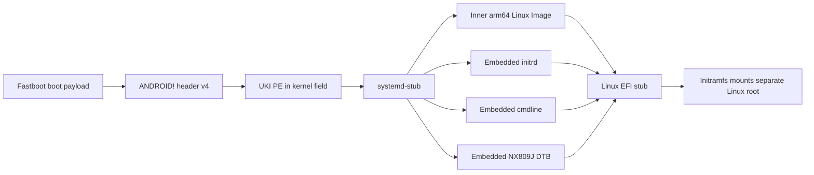

# EFI Linux handoff for the NX809J

Reviewed 2026-10-19. This host-only assessment describes a candidate way to carry all Linux boot inputs through the saved EFISP Fastboot `boot` contract. Host prerequisites are now installed and a synthetic format fixture has passed. No NX809J UKI or Android wrapper was built, no firmware was run, and the phone was not accessed.

## Finding

The saved EFISP callback accepts an Android `ANDROID!` boot-image wrapper and passes only the wrapper's `kernel` bytes to UEFI `LoadImage` and `StartImage`. It ignores the wrapper's Android ramdisk and command line. A UKI fits this limitation: its outer PE image can carry the kernel, initramfs, command line, and board DTB in sections, so systemd-stub can restore those inputs before starting Linux. [Boot-chain evidence](boot-chain.md)



This is a format path to prepare for review. The project has not established that the current USB Fastboot session executes the saved EFISP image, or that its UEFI policy accepts a custom UKI.

## How the UKI carries the missing inputs

`ukify` produces one PE image with sections for the Linux binary, initrd, command line, and optional DeviceTree. systemd-stub reads those sections from the outer UKI. On this phone, an embedded `.cmdline` is needed because the saved EFISP calls `StartImage` with null load options. A static `.dtb` section is preferable for the first build; `.dtbauto` matching relies on firmware-provided compatibles or hardware IDs that are not established for this phone. [systemd-stub 257.13](https://www.freedesktop.org/software/systemd/man/257/systemd-stub.html) · [ukify 257.13](https://www.freedesktop.org/software/systemd/man/257/ukify.html)

The pinned systemd 257.13 path confirms how these inputs reach the inner kernel: systemd's EFI Linux loader sets the inner image's `EFI_LOADED_IMAGE_PROTOCOL.LoadOptions` from the command line and registers the initrd through the Linux `LINUX_EFI_INITRD_MEDIA_GUID` / `EFI_LOAD_FILE2` device path before `StartImage`. The Linux arm64 EFI stub loads the initrd through that protocol, then uses the UEFI environment to finish kernel setup. systemd's inner-image security override allows its embedded kernel to be unsigned when the outer stub is already trusted; it does not prove that this phone will accept the outer UKI. [systemd `linux.c` v257.13](https://github.com/systemd/systemd/blob/v257.13/src/boot/linux.c) · [systemd `initrd.c` v257.13](https://github.com/systemd/systemd/blob/v257.13/src/boot/initrd.c) · [Linux EFI stub helper at the pinned kernel revision](https://github.com/torvalds/linux/blob/c03c1a14507dfaf8b856c2608f9ac216021fc222/drivers/firmware/efi/libstub/efi-stub-helper.c)

For DeviceTree, systemd-stub replaces the DeviceTree in the UEFI configuration table with the UKI's `.dtb` section and asks firmware for `EFI_DT_FIXUP_PROTOCOL` hardware-specific fixups. The protocol's presence and behavior on the NX809J boot path are unknown. Do not assume the Android FDT is already a correct mainline board DTB. [systemd-stub DeviceTree rules](https://www.freedesktop.org/software/systemd/man/257/systemd-stub.html)

## Pinned kernel evidence

The existing Linux 7.3 reference build already has `CONFIG_EFI=y`, `CONFIG_EFI_STUB=y`, `CONFIG_EFI_GENERIC_STUB=y`, `CONFIG_EFI_PARAMS_FROM_FDT=y`, `CONFIG_EFI_ARMSTUB_DTB_LOADER=y`, `CONFIG_OF=y`, and `CONFIG_BLK_DEV_INITRD=y`. `llvm-objdump -p` identifies its `Image` as COFF ARM64, PE32+, subsystem EFI Application, SHA-256 `b4fa54db9b11078a417b038c7c7b9fa9cc05f32dd8e1ebbfe45e5c8b8b60e39f`. This is the pinned Kaanapali reference build, not an NX809J image; upstream still has no Canoe/NX809J DTS. The build's `.config` has `CONFIG_SCSI_UFS_QCOM=m`, and the existing build produced no modules. This blocks an **internal-UFS-root** initramfs on this exact build. It does not block an external USB-storage root: that path needs a tested USB host/role/PHY and storage stack, their initramfs dependencies and firmware, and safe power/PD behavior; it does not need UFS. See [mainline readiness](mainline-readiness.md) and the saved [host inspection](../artifacts/boot-analysis/handoff/).

The Linux ARM64 EFI stub is enabled by `CONFIG_EFI_STUB`; with `CONFIG_EFI`, the pinned arm64 Kconfig selects the generic stub and FDT-based EFI parameters. The arm64 kernel requires a DTB. For UEFI boots, current kernel documentation says the stub removes DT memory nodes and Linux uses the UEFI memory map instead; the stub records the UEFI system table and memory-map location in FDT `/chosen`. The DT still must describe device topology and preserve reserved-memory carveouts, while the firmware memory map must correctly reserve secure and firmware-owned memory. The AArch64 boot protocol also constrains DTB placement, kernel placement, and the initrd's physical-memory window. [pinned Linux EFI-stub documentation](https://github.com/torvalds/linux/blob/c03c1a14507dfaf8b856c2608f9ac216021fc222/Documentation/admin-guide/efi-stub.rst) · [pinned AArch64 boot protocol](https://github.com/torvalds/linux/blob/c03c1a14507dfaf8b856c2608f9ac216021fc222/Documentation/arch/arm64/booting.rst) · [Linux UEFI on ARM](https://docs.kernel.org/next/arm/uefi.html) · [pinned EFI memory-map helper](https://github.com/torvalds/linux/blob/c03c1a14507dfaf8b856c2608f9ac216021fc222/drivers/firmware/efi/libstub/efi-stub-helper.c)

The saved Android FDT identifies the board as `qcom,canoe-mtp` / `qcom,canoe`. A mainline NX809J DTB must be built and checked from the verified phone FDT and source overlays; do not substitute the Kaanapali MTP/QRD or OnePlus DTBs. Its panel, touch, UFS power/clock wiring, reserved memory, and other board-specific nodes remain unported or unvalidated. [mainline readiness](mainline-readiness.md)

## Host-only build and verification contract

The Debian 13 WSL host now has the minimal `systemd-ukify=257.13-1~deb13u1` package installed without recommended packages. `ukify --version` reports `257.13-1~deb13u1`. The matching `systemd-boot-efi` ARM64 package at the same version was downloaded from Debian and extracted only; it was not installed. Its `linuxaa64.efi.stub` is COFF ARM64, PE32+, EFI Application subsystem. Package and file hashes are recorded in [`host-tools.json`](../artifacts/boot-analysis/handoff/host-tools.json). `ukify` was explicitly pointed at this ARM64 stub in the fixture, avoiding accidental use of a host-x86 stub.

The exact future UKI command is below. It must wait until the NX809J DTB and initramfs exist and have been reviewed. `ROOTFS` supplies the target Debian `os-release`, avoiding host metadata. This command was validated only with synthetic inputs by [`check_host_formats.py`](../artifacts/boot-analysis/handoff/check_host_formats.py); it has not been run with the Kaanapali reference kernel or any NX809J inputs.

```sh
KERNEL=/home/rm11build/redmagic-linux/kernel-build/c03c1a14507dfaf8b856c2608f9ac216021fc222/arch/arm64/boot/Image
INITRD=/path/to/debian-arm64-nx809j-initramfs.cpio
DTB=/path/to/qcom-nx809j.dtb
CMDLINE=/path/to/nx809j-kernel-command-line.txt
ROOTFS=/path/to/debian-arm64-rootfs
STUB=/home/rm11build/redmagic-linux/efi-handoff/extracted/usr/lib/systemd/boot/efi/linuxaa64.efi.stub
UKI=/path/to/nx809j.efi

ukify build \
  --efi-arch=aa64 \
  --stub="$STUB" \
  --linux="$KERNEL" \
  --initrd="$INITRD" \
  --cmdline="@$CMDLINE" \
  --devicetree="$DTB" \
  --os-release="@$ROOTFS/etc/os-release" \
  --output="$UKI"

ukify inspect "$UKI" --all --json=pretty > "$UKI.sections.json"
llvm-objdump -p "$UKI"
```

Review the UKI section inventory, sizes, and hashes. Require PE32+ ARM64 with EFI Application subsystem, `.linux`, `.initrd`, `.cmdline`, and `.dtb` sections; verify the inner `.linux` section is the intended pinned ARM64 `Image`. The embedded command line must point at the future external root and include only kernel options that have been reviewed. No outer Android command line or ramdisk should be relied on.

The preferred wrapper generator is the official AOSP `mkbootimg.py` at pinned `android16-release` commit `808ecd09666ffe0ff5800f02af693abce56eb395`, checked out under `/home/rm11build/redmagic-linux/efi-handoff/aosp-mkbootimg`. The local vendor-tree `mkbootimg_v4.py` was not selected: it is a small custom derivative, hardcodes `module_blacklist=kernelsu`, and does not provide the clean, attributable input contract needed here. The saved EFISP callback tests `header_version > 2` and then uses fixed kernel offset `0x1000`; the evidence shows no v4-specific rejection. AOSP v4 is therefore the preferred candidate envelope, although actual image acceptance remains unknown.

Once an NX809J UKI exists and wrapper generation is authorized, the exact host command is:

```sh
WRAPPER=/path/to/nx809j-fastboot-wrapper.img
python3 /home/rm11build/redmagic-linux/efi-handoff/aosp-mkbootimg/mkbootimg.py \
  --kernel="$UKI" \
  --header_version=4 \
  --pagesize=4096 \
  --cmdline='' \
  --output="$WRAPPER"
```

For header v4, AOSP writes the kernel payload at fixed offset `0x1000`, pads it to 4096 bytes, and records the exact kernel byte length at `0x08`. The outer `--cmdline` is intentionally empty: the saved callback does not pass it through, and systemd-stub reads the real kernel command line from the UKI `.cmdline` section. Omitting `--ramdisk` produces a zero-size Android ramdisk; omitting `--vendor_boot` means this is only an envelope for this particular callback, not a complete Android boot package. It is never a flashable Android image.

The host-only fixture verified AOSP v4 output with `ANDROID!` at byte 0, version 4 at `0x28`, header size 1584 at `0x14`, the kernel size at `0x08`, and an ARM64 PE `MZ` image at `0x1000`; the kernel field is page-padded and ramdisk size is zero. Its kernel, initrd, and DTB are deliberately invalid synthetic byte strings, so the generated temporary UKI and wrapper are **not bootable**. Results are in [`host-format-check.json`](../artifacts/boot-analysis/handoff/host-format-check.json). The callback format facts come from the bounded static evidence in [boot-chain.md](boot-chain.md), not from executing the fixture.

Sources: [AOSP boot-image header](https://source.android.com/docs/core/architecture/bootloader/boot-image-header) · [Pinned AOSP `mkbootimg.py`](https://android.googlesource.com/platform/system/tools/mkbootimg/+/808ecd09666ffe0ff5800f02af693abce56eb395/mkbootimg.py) · [Pinned AOSP header definition](https://android.googlesource.com/platform/system/tools/mkbootimg/+/808ecd09666ffe0ff5800f02af693abce56eb395/include/bootimg/bootimg.h)

The real-input commands above were not run. Only the temporary synthetic UKI and Android wrapper described by the fixture record were generated; neither is a phone-target image.

## Unresolved gates

- **Board DTB:** the four-patch NX809J review DTS/DTB exists and has three remaining shared schema warnings. GPU/GMU/SMMU/IMEM probes are disabled and UFS remains inherited-disabled. This is not a complete or boot-validated board; memory-map ownership, platform resources and the remaining binding/runtime gates are unresolved. See [the current follow-up](nx809j-schema-followup.md).
- **EFI configuration data:** verify that the actual path supplies a usable UEFI system table, memory map, configuration-table FDT, and needed fixups. The saved EFISP calling `LoadImage`/`StartImage` does not prove those kernel-facing interfaces.
- **Outer image policy:** the UKI itself is the PE loaded by the saved EFISP. The device's signature policy and whether it accepts an unsigned or custom-signed UKI are unknown. Fastboot `secure:yes` is not proof of UEFI Secure Boot policy.
- **Initramfs/root:** every root path needs an initramfs able to find and mount it. An external USB-storage root needs tested USB host/role/PHY and storage support plus dependencies, firmware, and safe power/PD behavior; it avoids the internal UFS driver. An internal-UFS root additionally needs the matching UFS driver built-in or packaged with its dependencies and firmware. An absent root must fail safely.
- **Dual boot:** this handoff path neither assigns a Linux slot nor solves Android/Linux switching. Keep Android A unchanged; do not create a phone image or test a boot until the existing recovery and user-data gates pass.

The PE/config observations, hashes, host-tool provenance, and fixture results used here are recorded in [`artifacts/boot-analysis/handoff/evidence.json`](../artifacts/boot-analysis/handoff/evidence.json), [`host-tools.json`](../artifacts/boot-analysis/handoff/host-tools.json), and [`host-format-check.json`](../artifacts/boot-analysis/handoff/host-format-check.json). These are local analysis records; none is a phone-target boot image.
